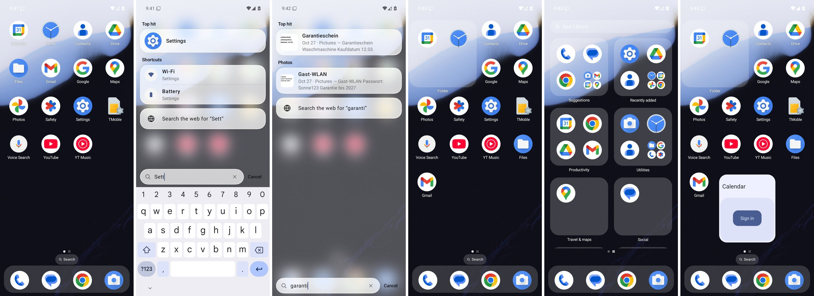

# WEWEWE – ein Launcher mit Spotlight-Suche für Android

Ein Homescreen für Android 16 und neuer, dessen Kern eine geräteweite Suche nach dem Vorbild von iOS
Spotlight ist. Ein Wischen nach unten an beliebiger Stelle öffnet die Suche, und die Tastatur fährt dabei
mit dem Finger hoch. Ohne Eingabe zeigt die Suche Vorschläge, mit Eingabe Treffer aus allen
Quellen, gruppiert und mit dem besten Treffer ganz oben. Alles bleibt auf dem Gerät.



Welche Quelle Android unter welcher Bedingung erlaubt und warum die Architektur so aussieht, steht in
[docs/QUELLEN.md](docs/QUELLEN.md).

## Funktionen

- **Wischgeste mit mitlaufender Tastatur**: Die Tastatur folgt dem Finger Bild für Bild
  (`WindowInsetsController.controlWindowInsetsAnimation`). Loslassen öffnet oder schließt je nach Weg und
  Tempo. Das Suchfeld hat auf dem Homescreen schon den Fokus, ohne Tastatur. Deshalb steht die Verbindung
  zur Tastatur-App, bevor der Finger das Display berührt.
- **Tippen auf einer Hardware-Tastatur** öffnet die Suche direkt vom Homescreen aus.
- **Liquid Glass wie in Velo**: Suchfeld und Trefferflächen brechen und verwischen den Homescreen dahinter
  (Kyant Backdrop). Das Hintergrundbild wird über den systemweiten Fenster-Blur weichgezeichnet. Die
  Textfarben richten sich nach dem Glas, nicht nach dem Hintergrund, und bleiben so auf jedem Bild lesbar.
- **Vorschläge ohne Eingabe**: acht Apps nach Tageszeit, Wochentag und Häufigkeit, dazu passende
  App-Verknüpfungen (die selbst oft genutzten und die wichtigsten der vorgeschlagenen Apps). Mit
  Nutzungsdatenzugriff zählt die Nutzung der letzten 30 Tage, auch außerhalb des Launchers. Ohne ihn bittet
  die Suche einmal darum.
- **Treffer mit Eingabe**: „Top-Treffer“, darunter Gruppen je Quelle, sortiert nach ihrem besten Treffer.
  Jedes Wort ist ein Präfix („goo ma“ findet Google Maps). Umlaute gehen in beiden Schreibweisen
  („Müller“, „Mueller“, „Muller“), Telefonnummern ab jeder Stelle, Initialen („gm“). Tippfehler in Apps,
  Einstellungen, Verknüpfungen und Kontakten werden verziehen („spotfy“, „yuotube“, „bluetoth“). Was man
  öfter auswählt oder benutzt, steigt im Ranking. Die Treffer stapeln sich vom Suchfeld nach oben, der
  beste sitzt also direkt über dem Daumen (umschaltbar); Enter öffnet den Top-Treffer.
- **Rechner und Einheiten** wie bei Spotlight: „12*7“, „5x5“, „(2+3)^2“, „200+15%“, „15% von 80“, „sin 30“,
  „5!“, „2π“, „5 km in mi“, „100 f in c“, „3,5 kg in pfund“, „1 gb in mb“. Das Ergebnis steht direkt im
  Suchfeld („= 84“, antippen rechnet damit weiter) und darüber als Treffer (antippen kopiert). Alles auf dem
  Gerät, deshalb ohne Währungen.
- **Timer und Wecker aus der Suche**: „timer 5 min“, „10 minuten timer“, „wecker 7:30“, „wake me at 7 am“;
  Enter oder Antippen startet den Timer bzw. stellt den Wecker in der Uhr-App.
- **Systemeinstellungen** als Quelle: WLAN, Bluetooth, Akku, Display, Ton, Bitte nicht stören, Standort …
  auf Deutsch und Englisch; die Taschenlampe schaltet direkt aus der Suche.
- **Aktionen in Treffern**: Kontakte direkt anrufen, schreiben oder mailen; „Im Play Store suchen“ neben der
  Websuche; „Zuletzt gesucht“ in der leeren Suche (nur auf dem Gerät, löschbar).
- **Quellen**: Apps (auch Arbeitsprofil), Systemeinstellungen, App-Verknüpfungen, Kontakte, Kalender, Velo-Verlauf und -Favoriten, Notizen aus freigegebenen Ordnern (Obsidian öffnet
  direkt die Notiz), Dokumente (Name, bei Text/Markdown/PDF auch Inhalt) und Fotos auf dem Gerät nach
  Album und Aufnahmemonat („Screenshots“, „Oktober 2025“), nach Inhalt („Hund“, „Strand“, „Kuchen“) und
  nach dem Text darin. „In Google Fotos suchen“ öffnet Google Fotos mit dem Suchbegriff, für Fotos, die
  nur in der Cloud liegen (Google lässt andere Apps die Fotomediathek nicht mehr durchsuchen).
- **Erkennung nur beim Laden**: ML Kit mit gebündelten Modellen erkennt Text in Fotos und was sie zeigen,
  auf dem Gerät. Das passiert in einem `JobScheduler`-Job, der nur bei angeschlossenem Ladegerät läuft und
  beim Abstecken pausiert. Album und Datum sind sofort durchsuchbar.
- **Index aktualisiert sich selbst**: `LauncherApps.Callback`, `ContentObserver` für Kontakte, Kalender,
  Medien und Velo, MediaStore-Generationen für inkrementelle Bild- und Dokumentänderungen, regelmäßiger
  Abgleich der Notiz-Ordner.
- **Bearbeitungsmodus wie bei iOS**: Langes Drücken auf den Hintergrund, „Home-Bildschirm bearbeiten“ im
  Menü einer App oder das Ziehen eines Elements startet ihn. Alles wackelt, ein graues Minus nimmt Apps,
  Ordner und Widgets vom Home-Bildschirm (Apps bleiben in der App-Mediathek), und Elemente lassen sich
  sofort verschieben. Die Leiste unten bietet „Widget hinzufügen“, Seiten, Hintergrundbild, Einstellungen
  und „Fertig“. Beenden auch per Tipp auf freie Fläche, Home oder Zurück.
- **Ganze Seiten entfernen**: Im Bearbeitungsmodus zeigen „Seiten“ (oder ein Tipp auf die Seitenpunkte) alle
  Seiten in Miniatur. Das Minus entfernt eine Seite nach Rückfrage; ihre Apps bleiben in der App-Mediathek,
  Widgets und Ordner der Seite verschwinden, die folgenden Seiten rücken nach.
- **Langes Drücken auf eine App wie beim Pixel Launcher**: ihre Benachrichtigungen (Antippen öffnet sie),
  ihre Verknüpfungen mit Symbol, jede per „+“ auch als eigenes Symbol auf dem Home-Bildschirm, „Widgets“ der
  App, „App-Timer“ (Digital Wellbeing), dazu Dock, „Vom Home-Bildschirm entfernen“, „Home-Bildschirm
  bearbeiten“, App-Info und Deinstallieren. Benachrichtigungspunkte an Symbolen und in Ordnern, sobald der
  Zugriff in den Einstellungen erlaubt ist. „Zum Startbildschirm hinzufügen“ aus anderen Apps (z. B. eine
  Seite aus Chrome) legt die Verknüpfung nach Bestätigung auf den Home-Bildschirm.
- **Homescreen frei anordnen**: Was im Weg steht, rückt zur Seite. Am
  Bildschirmrand blättert die Seite um, und hinter der letzten Seite entsteht eine neue. Die erste Anordnung
  stellt die meistgenutzten Apps nach vorn. Über die Seitenpunkte wischen springt zwischen den Seiten.
- **Ordner in vier Formen** (Menü beim langen Drücken auf den Ordner): als klassischer Ordner wie auf
  Pixel-Handys (ein Feld, Antippen öffnet ihn) oder als Fläche im Stil von Nothing OS, deren Apps sich direkt
  antippen lassen: 1 Feld mit 1×2 Apps, 3 Felder mit 2×3 Apps oder 4 Felder mit 3×3 Apps. Flächen fassen bis
  zu neun Apps, klassische Ordner beliebig viele. „Verspielt anordnen“ verschiebt und kippt die Symbole einer
  Fläche leicht, immer gleich für denselben Ordner. Ein Name aus nur einem Leerzeichen blendet den Namen aus.
  Eine App auf eine andere ziehen erzeugt einen Ordner; der Rand einer Fläche öffnet ihn zum Umbenennen.
- **Raster** wählbar (4×5 bis 6×7), Standard 5×6 auf Handys. Beim Wechsel bleibt alles an seinem Platz,
  soweit es passt; Symbole werden bei vielen Spalten kleiner.
- **App-Mediathek** rechts neben der letzten Seite, wie bei iOS, oder mit einem Wisch nach oben wie die App-Übersicht beim Pixel: Vorschläge, zuletzt installiert und Kategorien,
  die die Apps selbst angeben, jeweils nach Nutzung sortiert. Neue Apps landen wahlweise nur hier.
- **Widgets**: im Bearbeitungsmodus über „Widget hinzufügen“. Die Auswahl zeigt Vorschauen, danach folgt
  bei Bedarf die einmalige Erlaubnis und der Einrichtungsbildschirm des Widgets. Die Größe ändert ein Tipp
  auf das Widget im Bearbeitungsmodus oder langes Drücken.
- **Dock** mit bis zu fünf Apps, per Ziehen oder Menü befüllbar. Ein freier Platz zeigt eine vorgeschlagene
  App (Ring), wie beim Pixel Launcher, aber aus der eigenen Vorhersage nach Tageszeit und Nutzung; langes
  Drücken behält sie im Dock oder schaltet die Vorschläge ab. Darüber ein kleiner Suchen-Knopf wie bei iOS.
  Statusleiste und Beschriftungen passen sich an helle und dunkle Hintergrundbilder an.
- **Einstellungen** („Launcher & Suche“): jede Quelle einzeln abschaltbar, fehlende Berechtigungen mit
  einem Tipp erteilen, Notiz-Ordner verwalten, Fortschritt der Texterkennung, Messwerte, Index neu aufbauen.
- Deutsch und Englisch, Hell- und Dunkelmodus, Material-You-Farben.

## Zeitbudget und Messung

| Messwert | Budget | Gemessen von … bis … |
|---|---|---|
| Tastatur | < 150 ms | Wischgeste erkannt (Touch-Slop überschritten) → erster Frame, in dem die Tastatur sichtbar ist |
| Ergebnisse | < 50 ms | Eingabe geändert → Frame, der die Ergebnisse zeigt (konservativ: bis zum Beginn des Folgeframes) |

Beides misst die App selbst auf dem Gerät. Unter *Launcher & Suche › Messwerte* stehen Median,
95. Perzentil und Maximum der letzten 200 Messungen. Jeder Einzelwert steht außerdem im Logcat:

```bash
adb logcat -s LauncherPerf
```

Der Suchkern allein braucht für 26.000 Einträge (darunter 20.000 Fotos mit Text) im Schnitt 3–4 ms je
Tastendruck auf einem Desktop-JVM. Ein Unit-Test (`SearchPerformanceTest`) wacht darüber. Die Suche läuft auf
einem eigenen Thread, und eine neue Eingabe bricht die vorige Suche ab.

## Datenschutz

- **Nur der Updater geht ins Netz.** Die Internetberechtigung gibt es ausschließlich für die Suche nach
  eigenen Updates bei GitHub. Die CI bricht ab, sobald außerhalb von `update/` Netzwerkcode auftaucht.
  Den Meldekanal, über den ML Kit Nutzungsstatistiken senden würde, entfernt der Build aus dem Manifest; auch
  das prüft die CI am fertigen APK. Suchanfragen, Index und Texterkennung bleiben auf dem Gerät.
- Kein Backup (`allowBackup=false`). Der Index liegt im App-Speicher: OCR-Text, Dokument- und
  Notizinhalte in SQLite, alles andere nur im Arbeitsspeicher.
- Eine Websuche (letzte Zeile der Treffer) übergibt die Eingabe erst auf Antippen an Velo, die
  Play-Store-Suche an den Play Store.
- Benachrichtigungen liest der Launcher nur mit erteiltem Zugriff und nur in den Arbeitsspeicher (für Punkte
  und das App-Menü); sie werden nie gespeichert oder weitergegeben. „Zuletzt gesucht“ liegt in den
  App-Einstellungen auf dem Gerät und lässt sich löschen.

## Technik

| | |
|---|---|
| Sprache / UI | Kotlin 2.4, Jetpack Compose (BOM 2026.09), Material 3 |
| Build | AGP 9.3, Gradle 9.7, Version Catalog |
| SDK | `compileSdk`/`targetSdk` 37 (Android 17), `minSdk` 36 (Android 16) |
| Texterkennung | ML Kit Text Recognition v2, gebündeltes Lateinisch-Modell |
| Glas | `io.github.kyant0:backdrop` 2.0.1, `io.github.kyant0:shapes` 1.2.1 (wie Velo) |
| Persistenz | DataStore Preferences, SQLite, JSON (Homescreen) |

### Aufbau

```
core/                          Suchkern ohne Android (Kotlin/JVM, Unit-Tests)
├── TextNormalizer.kt          Kleinschreibung, Diakritika, Umlaut-Varianten, Initialen
├── SearchIndex.kt             Präfixindex: sortierte Tokens, Postings, Feldgewichte
├── SearchEngine.kt            Teilindizes je Quelle, Top-K je Gruppe, Top-Treffer
├── Predictor.kt               Vorschläge nach Tageszeit/Wochentag/Häufigkeit; Engagement
├── Snippets.kt                Textausschnitt um den Treffer
└── HomeGrid.kt                Rasterregeln des Homescreens: freie Plätze, Verdrängen, leere Seiten
app/src/main/java/io/github/davydgky/launcher/
├── MainActivity.kt            Homescreen-Activity, Hintergrundbild-Farben
├── apps/                      Apps und Verknüpfungen (LauncherApps), Standard-Apps
├── sources/                   Eine Klasse je Suchquelle
├── index/                     SQLite-Speicher, MediaStore-Abfragen, Lade-Job (OCR, PDF-Text)
├── search/                    Repository, ViewModel, Vorschläge, Icons, Öffnen von Treffern
├── usage/                     Nutzungsstatistik (UsageStatsManager)
├── ui/                        Geste, Tastatursteuerung, Suchpanel, Trefferzeilen, Liquid Glass
├── home/                      Anordnung (Workspace), Seiten, Ordner, Dock, App-Mediathek, Ziehen
├── widgets/                   AppWidgetHost, Hinzufügen mit Erlaubnis und Einrichtung
└── settings/                  Einstellungen
```

## Velo anbinden

Velo stellt Verlauf und Favoriten über einen `ContentProvider` bereit:

| | |
|---|---|
| Authority | `io.github.davydgky.browser.searchdata` |
| Berechtigung | `io.github.davydgky.browser.permission.READ_SEARCH_DATA` (Laufzeitberechtigung) |
| `content://…/history` | `url`, `title`, `last_visited`, `visits` |
| `content://…/bookmarks` | `title`, `url`, `position` |

Die Berechtigung erteilt der Nutzer in *Launcher & Suche › Velo-Verlauf und -Favoriten*. Änderungen meldet
Velo mit `notifyChange`, und der Launcher liest dann neu ein.

## Bauen

```bash
./gradlew assembleDebug                 # APK unter app/build/outputs/apk/debug/
./gradlew :core:test testDebugUnitTest  # Unit-Tests
```

GitHub Actions spart Minuten: Ein Push auf einen Arbeitszweig kompiliert nur und führt die Unit-Tests aus;
reine Doku-Änderungen bauen gar nicht. Auf `main` (oder per „Run workflow“) folgen Release-Build, Lint, die
Netzwerk-Prüfungen (siehe Datenschutz) und der Emulator-Test (`scripts/emulator_smoke.py`). Er macht
ihn zum Standard, wischt nach unten und prüft, dass die Tastatur erscheint. Er tippt einen App-Namen, legt
ein Foto mit Text ab, simuliert das Laden, lässt die Texterkennung laufen und sucht nach einem Wort aus dem
Foto. Er legt einen Ordner per Ziehen an, öffnet die App-Mediathek, startet den Bearbeitungsmodus und
fügt ein Widget hinzu. Die
Screenshots liegen als Artefakt `screenshots` und zusätzlich unter der Git-Referenz `refs/screenshots/latest`
(`git fetch origin refs/screenshots/latest`). Abstürze oder ein „reagiert nicht“ des Launchers gelten als
kritisch; die übrigen Prüfungen sind informativ, weil der Software-Emulator langsam ist.

### Signatur und automatische Updates

Jeder Build von `main`, der den Emulator-Test ohne kritischen Fehler besteht, wird als GitHub-Release
`v0.1.<Build>` mit der APK `launcher-<Build>.apk` veröffentlicht. Der eingebaute Updater (`update/AppUpdater.kt`,
derselbe wie in Velo) sieht spätestens alle sechs Stunden nach. Er lädt neue Versionen nur im WLAN und nur von
den Release-URLs dieses Repos. Vor der Installation prüft er die SHA-256-Prüfsumme und das
Signaturzertifikat. Installiert wird über den `PackageInstaller`. Beim ersten Update fragt Android einmal
nach der Erlaubnis „Unbekannte Apps installieren“. Danach ist der Launcher selbst der Installer, und
Updates laufen ohne Rückfrage, sobald eine andere App im Vordergrund ist. Abschalten lässt sich das unter
*Launcher & Suche › Updates*.
Das Repository muss dafür öffentlich sein: Bei einem privaten Repository antwortet GitHub dem Updater
ohne Anmeldung mit „nicht gefunden“, und die App meldet „Keine Releases gefunden“.

Signiert wird mit `scripts/sign_release.sh`:

- Mit den Secrets `LAUNCHER_KEYSTORE_BASE64` und `LAUNCHER_KEYSTORE_PASSWORD` (Schlüssel-Alias `launcher`)
  signiert die CI mit APK-Signaturschema v3 und **Schlüsselrotation** vom öffentlichen Debug-Schlüssel auf
  den geheimen Release-Schlüssel. Installierte Versionen nehmen das Update an. Danach kann eine nur mit dem
  Debug-Schlüssel signierte APK den Launcher nicht mehr ersetzen. Der Emulator-Job prüft beides.
- Solange die Secrets fehlen, signiert sie mit dem Debug-Schlüssel aus `keystore/`. Updates funktionieren
  dann auch, aber der Schlüssel ist öffentlich. Einen eigenen Schlüssel legt man so an und hinterlegt ihn
  als Secrets im Repo:

  ```bash
  keytool -genkeypair -keystore release.p12 -storetype PKCS12 -alias launcher -keyalg RSA -keysize 4096 -validity 10000
  base64 -w0 release.p12   # Inhalt von LAUNCHER_KEYSTORE_BASE64
  ```

## Bekannte Grenzen

- Notizen nur aus Apps, die Dateien in einem Ordner ablegen. Google Keep, Samsung Notes und Cloud-Notizdienste
  bieten keine lokale Schnittstelle (siehe [docs/QUELLEN.md](docs/QUELLEN.md)).
- Notiz-Ordner melden Änderungen nicht zuverlässig. Sie werden beim Zurückkehren zum Homescreen abgeglichen,
  höchstens alle fünf Minuten.
- Der Private Space bleibt unsichtbar (dafür bräuchte der Launcher `ACCESS_HIDDEN_PROFILES`).
- Anordnung, Ordner und Widgets eines anderen Launchers lassen sich nicht übernehmen; sie liegen in dessen
  privatem Speicher.
- Das Glas bricht den Homescreen, nicht das Hintergrundbild selbst. Das Hintergrundbild ist ein eigenes
  Systemfenster und wird nur weichgezeichnet. Ist der Fenster-Blur aus (z. B. im Energiesparmodus), dunkelt
  die Suche es stattdessen ab.
- Die App-Vorschläge des Pixel Launchers kommen von „Android System Intelligence“ über eine System-API
  (`AppPredictionManager`), die nur vorinstallierte Launcher nutzen dürfen. Der Dock-Vorschlag nutzt
  deshalb die eigene Vorhersage.
- „Bubble“ im App-Menü: Andere Apps direkt in eine Bubble legen darf nur die Systemoberfläche. WEWEWE
  öffnet deshalb eine eigene Bubble und startet die App darin. Apps, die auf einer eigenen Aufgabe
  bestehen, öffnen sich trotzdem im Vollbild. Beim ersten Mal fragt Android nach Benachrichtigungen und
  Bubbles für WEWEWE (eine Benachrichtigung erscheint nie). Apps des Arbeitsprofils gehen nicht.
- Aus dem Pixel-Menü fehlen außerdem „App pausieren“ (pausieren dürfen nur System-Apps; „App-Timer“ öffnet stattdessen
  Digital Wellbeing für die App) und „Geteilter Bildschirm“ (startet nur die Systemoberfläche). Widgets, die
  andere Apps auf den Home-Bildschirm legen wollen, nimmt der Launcher noch nicht an, nur Verknüpfungen.
- Texterkennung nur für lateinische Schrift. Office-Dateien werden nur über den Namen gefunden.
- Für eine Veröffentlichung bei Google Play wären Erklärungen für `READ_CONTACTS` (ab Android 17),
  `MANAGE_EXTERNAL_STORAGE` und `PACKAGE_USAGE_STATS` nötig.

## Drittanbieter

- [Kyant Backdrop und Shapes](https://github.com/Kyant0/AndroidLiquidGlass), Apache License 2.0
- [ML Kit Text Recognition](https://developers.google.com/ml-kit/vision/text-recognition/v2), ML Kit Terms of Service
